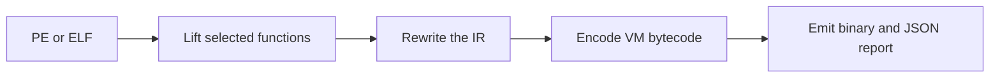

# vmkek

[Русский](README.ru.md) · [Architecture](docs/architecture.md) · [Roadmap](ROADMAP.md)

vmkek is a Rust toolkit for x86-64 software protection, binary rewriting, and code virtualization. It works with supported Windows PE and Linux ELF binaries. You choose which functions to protect and how much of the original binary to leave alone.

## What it does

| Capability | What is in the code |
| --- | --- |
| Obfuscation and mutation | Mixed Boolean-arithmetic rewrites, constant blinding, opaque predicates, and control-flow flattening. Selected functions can also be rewritten as native code. |
| Two VM levels in the native protector | The outer VM runs the protected function. An inner bytecode interpreter chooses handlers. Instruction encodings and handler layouts can vary between builds. |
| Experimental VM profiles | The separate Lab runtime has stack, register, and mixed forms. At depths 3 and 4, selected handler operations run as microprograms. Both depths have been exercised through the Windows C ABI on a lab machine. |
| Runtime checks | Supported Windows and Linux profiles check for debugging. Windows lab runs exercised debugger attachment, exception unwinding through virtualized calls, and selected CFG, CET shadow stack, and ACG configurations. |
| Authenticated offline profiles | The PE and ELF lab profiles use an independently supplied signing key. At startup they verify an ECDSA P-256 signature and authenticate the payload with ChaCha20-Poly1305. |
| Online runtime | The server issues signed sessions, delivers encrypted modules, and can revoke access. Selected operations can run on the server and return signed results. |
| Windows driver research | The experimental backend rewrites synthetic `.sys` images and preserves the Native subsystem. Image rewriting is tested. Live kernel loading, IOCTL, and unload are roadmap items. |



Z3 checks individual rewrite rules in the experimental Lab runtime over 64-bit bit vectors. In a previous native Linux run, `hex_digit`, `in_place_swap`, and `bounded_tlv` matched their reference outputs on 30 of 30 builds. Each set of ten seeds had a budget of 60 seconds and 8 GiB. These measurements describe execution on that corpus. The [architecture notes](docs/architecture.md#evidence) explain how we report correctness, cryptography, and resistance to analysis.

## Roadmap

Next up is a clean-clone example on each platform, followed by broader compatibility and performance measurements. The [roadmap](ROADMAP.md) gives the acceptance checks for each milestone, including independent evaluation, live driver validation, and recovery of the online service.

## Try it

With Rust 1.95.0 installed, run this from the repository root.

```sh
cargo +1.95.0 run --locked --bin vmkek -- --help
```

For a native Linux test using a synthetic ELF:

```sh
cargo +1.95.0 test --locked -p vmkek --test e2_linux
```

See the [Windows lab instructions](tests/windows/README.md) or the [Online sample](samples/online/README.md) for the prerequisites of those paths.

## Why I started it

I started out writing cheats. Later I got interested in taking software protections apart and figuring out which parts slowed me down. Since I started working in Big Tech in 2020, I’ve had less time for side projects and rarely published them on GitHub. With vmkek, I wanted to build the kind of thing I used to take apart.

## License

vmkek is source-available under [PolyForm Noncommercial 1.0.0](LICENSE). For commercial use of the project code in this release, see [commercial licensing](COMMERCIAL-LICENSING.md). [Third-party dependencies](LICENSES/README.md) retain their upstream licenses.
