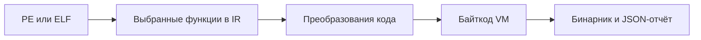

# vmkek

[English](README.md) · [Архитектура](docs/architecture.ru.md) · [Дорожная карта](ROADMAP.ru.md)

vmkek защищает и переписывает бинарники Windows PE и Linux ELF на x86-64. Проект написан на Rust. Можно выбрать функции для виртуализации и оставить остальной код в нативном виде.

## Что умеет vmkek

| Возможность | Что есть в коде |
| --- | --- |
| Обфускация и мутация | Булево-арифметические преобразования, маскирование констант, непрозрачные предикаты и уплощение графа потока управления. Выбранные функции можно переписывать и в нативном виде. |
| Два уровня VM в нативном протекторе | Внешняя VM исполняет защищённую функцию. Внутренний байткод выбирает обработчик. Кодировки инструкций и компоновка обработчиков могут различаться между сборками. |
| Экспериментальные профили VM | У отдельного Lab runtime есть стековая, регистровая и смешанная формы. На глубинах 3 и 4 выбранные операции обработчиков выполняются как микропрограммы. Обе глубины запускались на стенде Windows через C ABI. |
| Проверки при исполнении | В поддерживаемых профилях Windows и Linux есть антиотладка. На Windows проверили подключение отладчика, раскрутку исключений через виртуализированный вызов и отдельные конфигурации CFG, CET shadow stack и ACG. |
| Проверка подлинности офлайн | Лабораторные профили PE и ELF используют отдельный ключ подписи. При запуске они проверяют подпись ECDSA P-256 и подлинность зашифрованных данных через ChaCha20-Poly1305. |
| Online runtime | Сервер выдаёт подписанные сессии и зашифрованные модули, управляет отзывом доступа и может выполнять отдельные операции у себя. |
| Исследования Windows kernel mode | Экспериментальный бэкенд переписывает синтетические `.sys` с сохранением подсистемы Native. Структура выходного образа покрыта тестами. Загрузка в живом ядре, IOCTL и выгрузка в дорожной карте. |



В экспериментальном Lab runtime Z3 проверяет отдельные правила на 64-битных векторах. В предыдущем нативном прогоне на Linux функции `hex_digit`, `in_place_swap` и `bounded_tlv` совпали с эталоном на 30 из 30 сборок. На десять seed каждой функции отводилось 60 секунд и 8 ГиБ. Как мы разделяем корректность, криптографию и стойкость к анализу, описано в [архитектуре](docs/architecture.ru.md#evidence).

## Дорожная карта

Ближайшая задача состоит в том, чтобы человек мог повторить первый запуск из чистого клона. Дальше расширяем корпус, измеряем накладные расходы и проверяем стойкость. В [дорожной карте](ROADMAP.ru.md) есть критерии для каждого этапа, в том числе для драйверов и серверного контура.

## Быстрый старт

С установленным Rust 1.95.0 запусти эту команду из корня проекта.

```sh
cargo +1.95.0 run --locked --bin vmkek -- --help
```

На Linux можно запустить нативный тест на синтетическом ELF:

```sh
cargo +1.95.0 test --locked -p vmkek --test e2_linux
```

Для остальных стендов есть [инструкция Windows](tests/windows/README.md) и [пример онлайн-режима](samples/online/README.md).

## Почему я взялся за vmkek

Я начинал с разработки читов. Потом увлёкся разбором чужих защит. Хотелось понять, на чём я действительно теряю время и где получается быстро добраться до логики программы. С 2020 года я работаю в Big Tech. Времени на личные проекты стало меньше, и на GitHub я публиковался редко. С vmkek захотелось построить свою защиту и посмотреть на эту задачу с другой стороны.

## Лицензия

Исходный код vmkek доступен на условиях [PolyForm Noncommercial 1.0.0](LICENSE). Для коммерческого использования кода этого релиза предусмотрена [платная лицензия](COMMERCIAL-LICENSING.md#коммерческое-лицензирование). У [сторонних зависимостей](LICENSES/README.md) сохраняются их лицензии.
